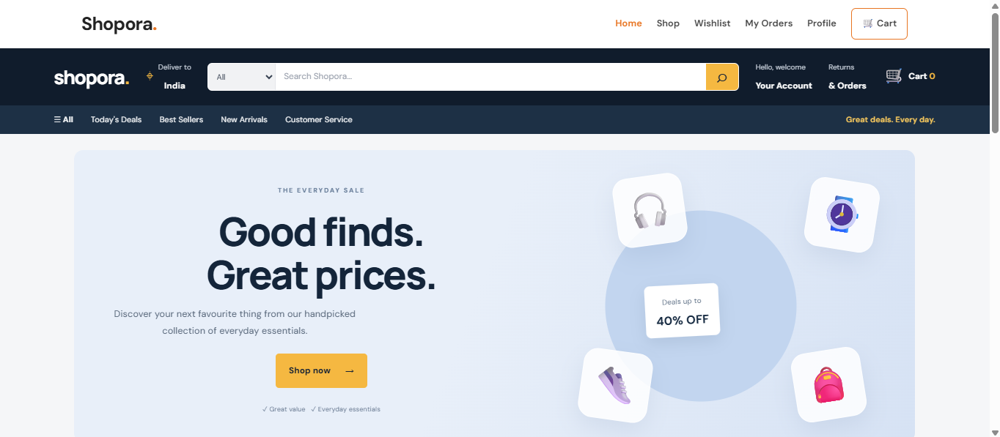
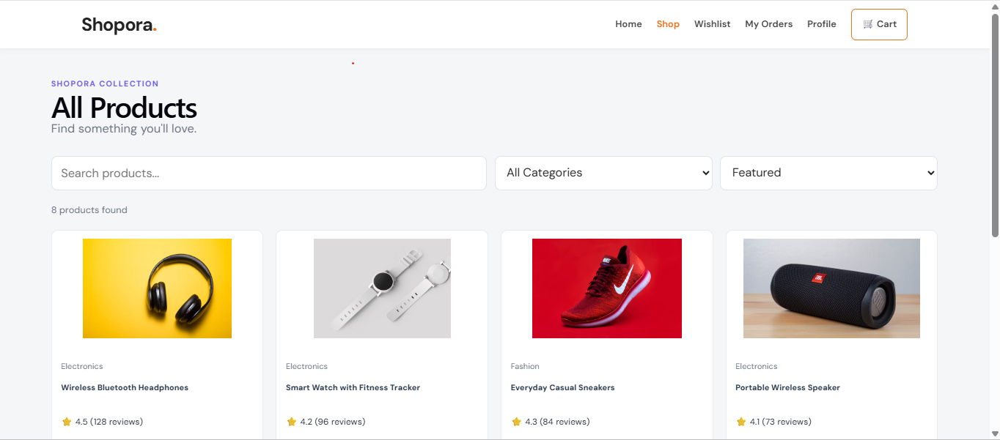
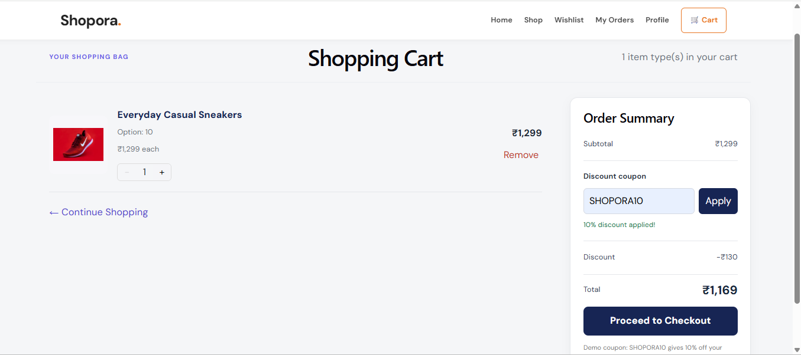
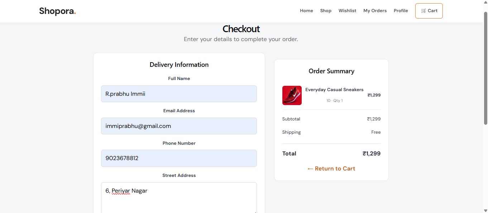

# React + Vite

This template provides a minimal setup to get React working in Vite with HMR and some ESLint rules.

Currently, two official plugins are available:

- [@vitejs/plugin-react](https://github.com/vitejs/vite-plugin-react/blob/main/packages/plugin-react) uses [Oxc](https://oxc.rs)
- [@vitejs/plugin-react-swc](https://github.com/vitejs/vite-plugin-react/blob/main/packages/plugin-react-swc) uses [SWC](https://swc.rs/)

## React Compiler

The React Compiler is not enabled on this template because of its impact on dev & build performances. To add it, see [this documentation](https://react.dev/learn/react-compiler/installation).

## Expanding the ESLint configuration

If you are developing a production application, we recommend using TypeScript with type-aware lint rules enabled. Check out the [TS template](https://github.com/vitejs/vite/tree/main/packages/create-vite/template-react-ts) for information on how to integrate TypeScript and [`typescript-eslint`](https://typescript-eslint.io) in your project.


# Shopora — E-Commerce Website

Shopora is a responsive e-commerce frontend built using React, JavaScript, and CSS. It provides a shopping experience where users can browse products, search and filter listings, manage a cart and wishlist, place demo orders, and maintain their profile.

## Features

- **Home Page:** Store landing page with featured products.
- **Product Listing:** Search, category filtering, sorting, and pagination.
- **Product Details:** Product descriptions, variant selection, quantity selection, and pricing.
- **Shopping Cart:** Add and remove items, update quantities, and apply a demo coupon.
- **Wishlist:** Save favourite products and move them to the cart.
- **Checkout:** Delivery form validation, order summary, and simulated order placement.
- **Order History:** View saved orders, purchased products, dates, and totals.
- **User Profile:** Save and edit personal and delivery information.
- **Responsive Navigation:** Shared navigation bar with a mobile menu.
- **Local Persistence:** Cart, wishlist, orders, and profile information are stored in browser localStorage.

## Technologies Used

- React
- JavaScript (ES6+)
- CSS3
- React Router
- Vite
- Browser localStorage

## Getting Started

### Prerequisites

Install Node.js and npm on your computer.

### Installation

1. Clone or download this project.
2. Open the project folder in VS Code.
3. Open a terminal in the `frontend` directory.
4. Install dependencies:

   ```bash
   npm install
   ```

5. Start the development server:

   ```bash
   npm run dev
   ```

6. Open the local URL shown in your terminal, usually `http://localhost:5173/`.

### Production Build

To check that the project builds successfully, run:

```bash
npm run build
```

To preview the production build locally, run:

```bash
npm run preview
```

## Project Structure

```text
frontend/
├── public/
├── src/
│   ├── components/
│   │   ├── Navbar.jsx
│   │   └── ProductCard.jsx
│   ├── context/
│   ├── data/
│   │   └── products.js
│   ├── pages/
│   │   ├── Home.jsx
│   │   ├── Products.jsx
│   │   ├── ProductDetails.jsx
│   │   ├── Cart.jsx
│   │   ├── Wishlist.jsx
│   │   ├── Checkout.jsx
│   │   ├── Orders.jsx
│   │   └── Profile.jsx
│   ├── App.jsx
│   ├── App.css
│   ├── index.css
│   └── main.jsx
├── index.html
├── package.json
└── README.md
```

## Screenshots

### Home Page


### Product Listing


### Product Details


### Shopping Cart


### Wishlist


### Checkout


### Order History


### User Profile


Add screenshots of the application to a `screenshots/` folder and include them here.

Suggested screenshots:

- Home page
- Product listing and filters
- Product details
- Shopping cart
- Wishlist
- Checkout
- Order confirmation and order history
- User profile

Example:

```markdown

```

## Demo Limitations

- This project is a frontend demonstration; it does not connect to a backend database.
- Product data is provided through mock data.
- Cart, wishlist, orders, and profile details are stored in browser localStorage.
- Online payment is simulated. No real payments are processed.
- User information is not managed through a real authentication system.

## Future Improvements

- Backend API and database integration
- User registration, login, and authentication
- Real payment gateway integration
- Product reviews and ratings
- Order tracking and administration dashboard
- Automated testing

## Author

**Your Name**

Replace this with your name or preferred GitHub profile link before submitting the project.